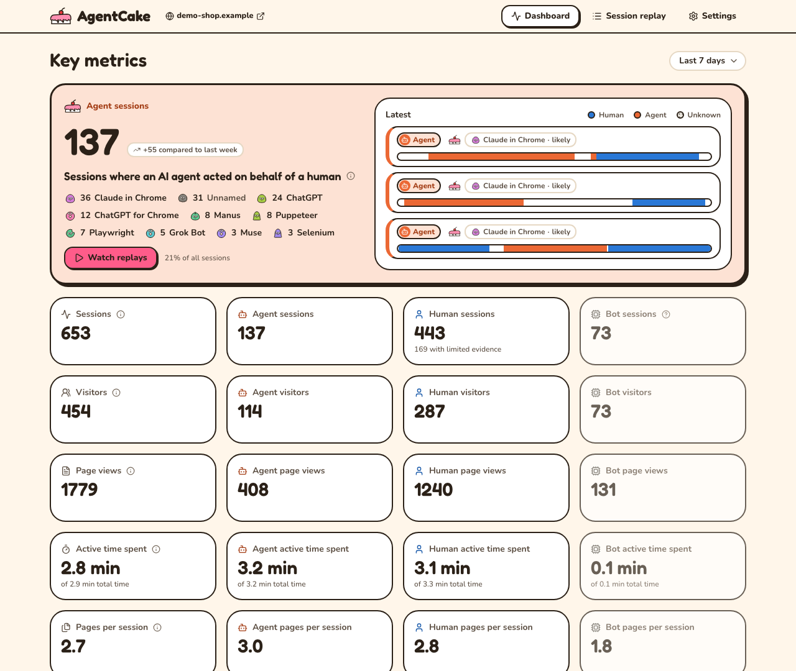
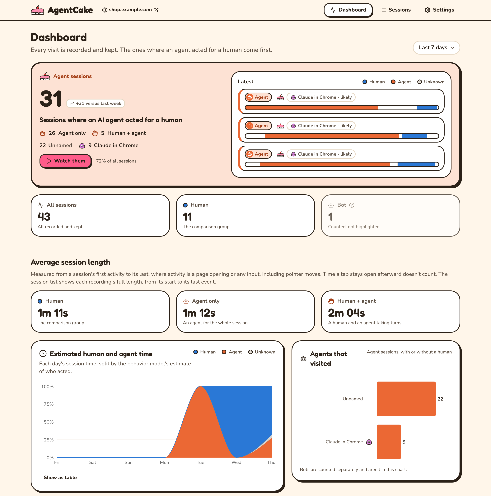
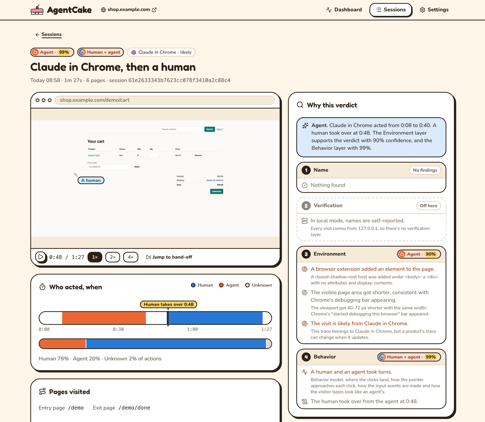
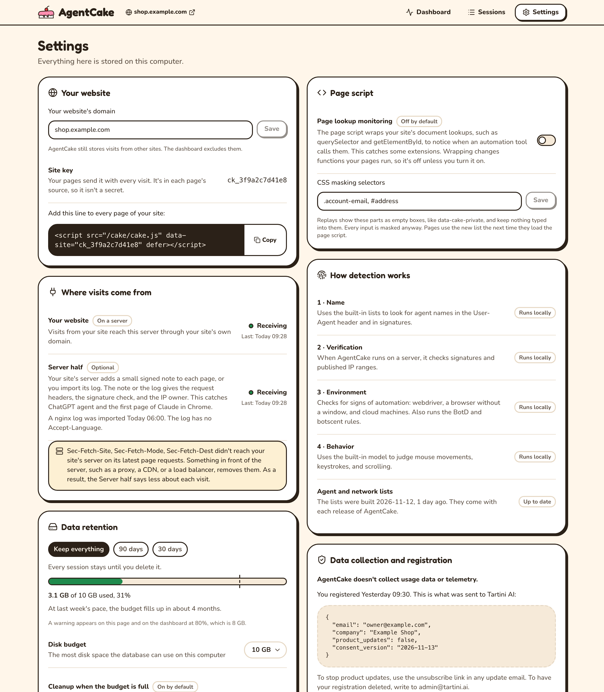

<div align="center">


# AgentCake — AI Agent Traffic Analytics

**See which visits to your website were humans and which were AI agents, what each did, and where a human took
over.**

[](https://github.com/tartini-ai/agent-traffic-analytics/releases)
[](https://github.com/tartini-ai/agent-traffic-analytics/issues)
[](LICENSE)

**English** · [简体中文](docs/locales/zh-CN/README.md)

</div>

Your website is getting a lot of visits, but the number of people buying your products remains the same or even
decreases. Do you want to figure out why? Some of those visits may be AI agents.

Do you want to understand how AI agents, such as Browser Use, Grok Bot, and Meta Muse, visit your website? How do these
agents behave, and what happens in mixed sessions involving both AI agents and humans (the dashboard calls them
Human + agent)?

We've launched AgentCake, a self-hosted AI agent traffic analytics platform. It provides session replays and uses our
behavioral model and rule-based criteria to distinguish between AI-driven, human-driven, and mixed sessions.

Since AI agents act for the humans who send them, these sessions can provide valuable insights into your customers.
Their replays help you find out:

1. **Did my AI agent customers find the information they needed?** Which pages did they view? Were they just browsing,
   or did they start signing up?
2. **At which step did they get blocked?** Should I optimize my website flow for specific use cases to make it more
   agent-friendly?
3. **Which AI agents visit my website most frequently (Claude in Chrome, Grok Bot, Muse, etc.)?** How can I optimize
   my website for these agents to increase conversions?



*Recorded on a test shop: Claude in Chrome puts a T-shirt in the cart, then a human takes over and checks out.
AgentCake marks the hand-off and shows why it judged each part.*

## Why AI agents are hard to see

**AI agents act on your website. Can you tell which clicks were theirs?**

- **Agentic traffic is already here.** Microsoft Clarity
  [counted more than 5.2 million sessions involving AI agents](https://clarity.microsoft.com/blog/agentic-analytics-what-agents-do-on-websites/)
  in four weeks of 2026, and weekly agent sessions nearly doubled in three weeks. Checkout appeared in 25% of those
  sessions, against 15% of human ones.
- **Agents look like your customers.** Claude in Chrome, Comet and ChatGPT agent drive a real browser: they load your
  pages, run your scripts, click and type. When they browse without a bot name, name-based bot controls
  [don't cover them](https://www.helpnetsecurity.com/2026/10/19/datadome-ai-agent-traffic-report/).
- **Your reports can miss the difference.** An agent your analytics don't recognize can count as a human visitor.
  Google Analytics [excludes known bots](https://support.google.com/analytics/answer/9888366) and doesn't show how
  many. Crawler reports show page requests, not who clicked inside the page.
- **One session, two drivers.** A human lets an agent fill the cart, then takes over to pay. Even Clarity, which now
  reports agent sessions, says it "cannot currently separate the agent and human portions" of such a session
  ([its study](https://clarity.microsoft.com/blog/agentic-analytics-what-agents-do-on-websites/)). Its 25% counts
  checkouts in sessions an agent took part in, not checkouts the agent made.

Your conversion rate, funnels and tests can mix agents with humans, and a session labelled "agent" still doesn't say
which clicks were whose.

## What AgentCake does

**Add cake.js (45 KB gzipped) to your pages to record each visit as a replay, inputs masked. AgentCake judges every
session on your own computer or server and shows the verdict, the replay and the evidence, so you can see what
happened.**



- **Human, AI agent or bot.** Every session gets one verdict. Sessions where an agent acted come first, split into
  Agent only and Human + agent. A session it can't classify counts as Human, marked thin evidence, with the reason.
  Bots are counted and kept, but never shown in the agent charts.
- **Which agent.** It names the agents it recognizes, such as Claude in Chrome, ChatGPT agent, Comet or Playwright,
  and lists the rest as Unnamed.
- **How sure.** Each name is Verified (a signature or a published IP range, checked on a server), Likely (the name the
  agent gives, or its traces) or Possible (behavior alone).
- **Who acted, when.** A timeline splits each session into human, agent and unknown stretches, marks the hand-offs it
  finds, and lists every action with who did it.
- **Where they went.** The pages agents visit most beside the pages humans visit most, which agents came, and how
  long each kind of session lasts.
- **Why.** Each verdict shows its evidence beside the replay, such as the name an agent sent, a mark it left on the
  page, or how its pointer moved before each click.
- **Self-hosted, open source.** One program and one SQLite database on your computer or server; your coding agent
  installs it from one sentence. No telemetry, no AI service called. MIT licensed.

**It isn't perfect.** We tested it on 14 data sets from about 350 websites. It recognized 347 of 405 agent sessions
from 26 tools, and mistook 2 of 7,122 sessions by at least 400 real people for an agent. Where a human and an agent
took turns, it judged 106 of 159 sessions Human + agent and put the hand-off a median of 0 seconds from the real one
([how each number is counted](eval/README.md)).



## Install

Open Claude Code, Codex or another coding agent in a new, empty folder and paste this sentence:

```text
Install AgentCake 0.4.1 for me with curl or the GitHub CLI by following
https://raw.githubusercontent.com/tartini-ai/agent-traffic-analytics/v0.4.1/INSTALL.md
and then tell me which local page to open and how to connect my website.
```

Your agent downloads the release, checks its checksums, installs the `agentcake` command, starts it and runs
`agentcake doctor`. Then open http://127.0.0.1:7878/ in your browser.

- **Requirements:** macOS or Linux, with Python 3.11 or newer, or with uv, which brings its own Python.
- **First open:** register with your e-mail address ([what is sent](#your-data-stays-yours)); the page then walks you
  through connecting your website.
- **By hand:** [`INSTALL.md`](INSTALL.md) has the same steps, one command each.
- **Private preview:** while the repository is private, sign in to the GitHub CLI first (`gh auth login`). Your agent
  then downloads the release with `gh release download v0.4.1 --repo tartini-ai/agent-traffic-analytics`.

## How it decides

**Four layers, all on your machine. No AI service is called.**

- **Name and verification.** Names come from the User-Agent and from signed requests, matched against lists that
  ship with each release. On a server, signatures and published IP ranges confirm them.
- **Environment and behavior.** Automation traces, an extension taking over the page, and how the pointer, keys and
  scrolling move.
- **What it sees.** Visits that run the page script: humans, AI agents in a real browser, automation tools and bots
  that render pages. A crawler that runs no JavaScript, or a visitor who declined analytics, isn't recorded.
- **What it recognizes.** Agents that name themselves or sign their requests (ChatGPT agent, Manus, Grok); agents that
  mark the pages they drive (Claude in Chrome, Comet, Browser Use); automation tools, named by the traces they leave
  (Playwright, Puppeteer, Selenium).
- **What it can't tell yet.** An agent that moves and types like a human, with no name and no trace, can pass as a
  human, and a session with too few actions can't be judged. [`eval/README.md`](eval/README.md) breaks down the
  totals above and shows where they fall short.

## Your data stays yours

**No telemetry. What your visitors do stays on your machine.**

- **Nothing sent.** The page script sends visits only to your own AgentCake. AgentCake sends no usage data, and goes
  online only when you ask: to register, to update its lists (`agentcake lists update`) or to check your own site
  (`agentcake doctor`).
- **Never recorded.** What visitors type, which keys they press, passwords, card numbers, cookies and IP addresses.
  If your site asks visitors for consent, it starts and stops recording (`window.cake.start()`, `window.cake.stop()`).
- **Registration, once.** The first time you open the local page, it asks you to register. Your e-mail address, your
  company if you give one, whether you want product updates and which consent text you saw go to Tartini AI only
  when you press "Register & Continue". Collecting visits and the command line work without it.



[`PRIVACY.md`](PRIVACY.md) says what is recorded, where it is kept and how to delete it;
[`docs/privacy-notice-template.md`](docs/privacy-notice-template.md) helps you tell your visitors.

## Connect your website

**One line in your pages, optional middleware on your server.**

After you register, the local page walks you through it in four steps. Its third step has a sentence for your coding
agent, to paste in your website's code folder. It names your `agentcake` by its full path, and reads like this:

> In this website's code folder, run `agentcake setup --print --site`, follow the steps it prints to connect AgentCake to this website, then run `agentcake doctor` and tell me the result and what is left for me to do.

- **The page script.** One line in your pages loads cake.js (45 KB gzipped). Its checks wait for the page to load and
  run while the browser is idle.
- **The server half.** For Next.js, Express, Flask, FastAPI, Django, PHP and WordPress, the setup also prints
  middleware that tells AgentCake what your server saw of each page request.

## Run it on a server

A site on this computer sends visits right away. A public website's visitors need AgentCake on a server, with Docker or
systemd: only the page script and the collect endpoint are public, on a path of your own site, and the dashboard stays
on the server's 127.0.0.1, behind an SSH tunnel. On a server, signatures and published IP ranges can also confirm who
an agent is. [`SERVER.md`](SERVER.md) has every step.

## Building from source

- **Release files:** `python3 -I tools/release.py build` builds the wheel, `agentcake.pyz`, the release folder and
  `SHA256SUMS` from the commit checked out; `python3 -I tools/release.py --help` says how.
- **With a coding agent:** give it [`AGENTS.md`](AGENTS.md). It says how to run AgentCake from this folder and how to
  change its interface ([`DESIGN.md`](DESIGN.md)).
- **Tests and contributing:** `python3 -I -m unittest discover -s tests -v`; [`CONTRIBUTING.md`](CONTRIBUTING.md) says
  which checks a pull request passes and the rules they keep.

## Help it get better

AgentCake is open source. Help make it more accurate by reporting its mistakes, telling us about agents it doesn't know
or sending tested changes:

- **Report a wrong verdict.** If it called an agent human, or a human an agent, open a
  [wrong verdict](https://github.com/tartini-ai/agent-traffic-analytics/issues/new?template=wrong_verdict.yml) issue. Describe the session in your own words and include the reasons AgentCake gave
  for its verdict; don't paste your visitors' data.
- **Tell us about an agent it doesn't know.** Name the agent and its version, what it did and what AgentCake said. If
  you recorded it on a page of your own, with no one else's visits, say so in the issue and we'll agree how to send
  the recording.
- **Improve the rules or the model.** The rules and the model's parameters are JSON files in `agentcake/data/`. Send
  a pull request with what `agentcake eval` shows before and after; we also run it on our own data. Show whether your
  change judges more humans as agents: we don't merge one that does. [`CONTRIBUTING.md`](CONTRIBUTING.md) has the
  steps.

## Feedback

- **Questions:** [`docs/FAQ.md`](docs/FAQ.md) answers the common ones, such as how accurate it is, what Human, Agent
  and Bot mean, and whether it blocks agents.
- **Bugs and ideas:** [GitHub Issues](https://github.com/tartini-ai/agent-traffic-analytics/issues).
- **Security vulnerabilities:** please don't open an issue; write to [admin@tartini.ai](mailto:admin@tartini.ai).
  [`SECURITY.md`](SECURITY.md) says what to include and what is in scope.

## License

MIT, copyright Tartini AI: see [`LICENSE`](LICENSE). The third-party code AgentCake bundles (rrweb, BotD, botscent
and the bot lists) keeps its own licenses, listed in [`THIRD_PARTY.md`](THIRD_PARTY.md).

<sub>AgentCake is an independent product and is not affiliated with, endorsed by or sponsored by the makers of the
agents and tools it names. All trademarks belong to their owners.</sub>
