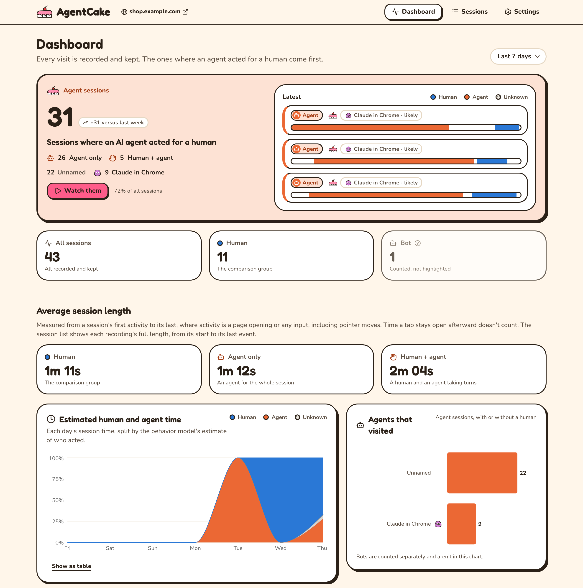

<div align="center">


# AgentCake — AI Agent Traffic Analytics

**看清访问你网站的哪些是真人、哪些是 AI agent，各自做了什么，真人又是在哪里接手的。**

[](https://github.com/tartini-ai/agent-traffic-analytics/releases)
[](https://github.com/tartini-ai/agent-traffic-analytics/issues)
[](../../../LICENSE)

[English](../../../README.md) · **简体中文**

</div>

你的网站访问量不少，买你产品的人却没有变多，甚至变少了。想知道为什么吗？这些访问里，可能有一部分是 AI agent。

你想了解 AI agent（比如 Browser Use、Grok Bot、Meta Muse）是怎么访问你的网站的吗？这些 agent 在网站上做了些什么？AI agent 和真人在同一个 session 里一起操作的混合 session（看板里叫 Human + agent）里，又发生了什么？

我们推出了 AgentCake，一个自托管的 AI agent 流量分析（AI agent traffic analytics）平台。它提供 session 回放，并用我们的行为模型和规则，把 session 分成 AI 操作的、真人操作的和两者混合的。

AI agent 是替派它来的真人做事的，所以这些 session 能帮你更了解你的顾客。看它们的回放，你可以弄清楚：

1. **用 AI agent 的顾客找到他们要的信息了吗？** 他们看了哪些页面？只是随便看看，还是开始注册了？
2. **他们卡在了哪一步？** 要不要针对某些场景优化网站流程，让 agent 用起来更顺？
3. **哪些 AI agent 来得最多（Claude in Chrome、Grok Bot、Muse 等）？** 怎么为这些 agent 优化网站，提高转化？


*录自一个测试网店：Claude in Chrome 把一件 T 恤加进购物车，然后真人接手去结账。AgentCake 标出接手的地方，并说明每一段为什么这样判。*

## 为什么 AI agent 难被看见

**AI agent 在你的网站上操作。你分得清哪些点击是它们的吗？**

- **Agent 流量（agentic traffic）已经来了。** Microsoft Clarity 在 2026 年的四周里[数到超过 520 万个有 AI agent 参与的 session](https://clarity.microsoft.com/blog/agentic-analytics-what-agents-do-on-websites/)，每周的 agent session 三周里涨了将近一倍。这些 session 里有 25% 出现了结账，真人的 session 只有 15%。
- **Agent 看起来就像你的顾客。** Claude in Chrome、Comet、ChatGPT agent 开的是真浏览器：打开页面、运行你的脚本、点击、打字。它们不报 bot 名字时，按名字管 bot 的那些设置就[管不到它们](https://www.helpnetsecurity.com/2026/10/19/datadome-ai-agent-traffic-report/)。
- **报表可能分不出来。** 分析工具认不出的 agent，可能被算成真人访客。Google Analytics [自动排除已知 bot](https://support.google.com/analytics/answer/9888366)，也不告诉你排除了多少。爬虫报表只看得到页面请求，看不到是谁在页面里点。
- **一个 session，两个操作者。** 真人先让 agent 把东西放进购物车，再自己接手去付款。连已经能报告 agent session 的 Clarity，也在[自己的研究](https://clarity.microsoft.com/blog/agentic-analytics-what-agents-do-on-websites/)里写明：目前分不开这种 session 里 agent 做的部分和真人做的部分。所以它那个 25%，数的是有 agent 参与的 session 里出现的结账，不是 agent 自己完成的结账。

你的转化率、漏斗和 A/B 测试里，可能混着 agent 和真人；就算一个 session 标着「agent」，也说不清哪些点击是谁的。

## AgentCake 做什么

**在页面里加上 cake.js（gzip 后 45 KB），把每次访问录成回放（输入都遮住）。AgentCake 在你自己的电脑或服务器上判断每个 session，把判定、回放和证据都摆出来，发生了什么你一看就知道。**



- **真人、AI agent 还是 bot。** 每个 session 都有一个判定。有 agent 操作过的 session 排在最前，分成「Agent only」（全程是 agent）和「Human + agent」（真人和 agent 轮流操作）。判断不出来的 session 算作 Human，标上「Thin evidence」（证据不够）并写明原因。bot 会计数、会保留，但不进 agent 的图表。
- **是哪个 agent。** 认得出的 agent 会叫出名字，比如 Claude in Chrome、ChatGPT agent、Comet 或 Playwright；叫不出名字的标「Unnamed」。
- **有多确定。** 每个名字都标上 Verified（签名或公开的 IP 段核实过，装在服务器上才有）、Likely（agent 自己报的名字，或者它留下的痕迹）或 Possible（只凭行为）。
- **谁在什么时候操作。** 时间线把每个 session 分成真人、agent 和未知（Unknown）几段，标出它找到的接手点，并列出每个操作是谁做的。
- **它们去了哪里。** agent 最常看的页面和真人最常看的页面并排，来了哪些 agent，每类 session 平均多长。
- **为什么这样判。** 每个判定都在回放旁边列出证据，比如 agent 报出的名字、它在页面上留下的标记，或者每次点击前鼠标是怎么移过去的。
- **自托管，开源。** 一个程序加一个 SQLite 数据库，跑在你的电脑或服务器上；你的 coding agent 照一句话就能装好。不发遥测，不调用任何 AI 服务。MIT 许可证。

**它并不完美。** 我们在 14 份数据、约 350 个网站上测过：来自 26 种工具的 405 个 agent session，它认出了 347 个；至少 400 个真人的 7,122 个 session，它把 2 个误判成 agent。真人和 agent 轮流操作的 159 个 session 里，它把 106 个判成 Human + agent，标出的接手点离真实接手点的中位误差是 0 秒（[每个数怎么算的](../../../eval/README.md)）。


## 安装

在一个新的空文件夹里打开 Claude Code、Codex 或别的 coding agent，把这句话贴进去：

```text
帮我用 curl 或 GitHub CLI 安装 AgentCake 0.4.1，照着
https://raw.githubusercontent.com/tartini-ai/agent-traffic-analytics/v0.4.1/INSTALL.md
做，最后告诉我打开哪个本机页面，以及怎么接上我的网站。
```

你的 agent 会下载发布文件、核对校验和、安装 `agentcake` 命令、启动它并运行 `agentcake doctor`。然后在浏览器里打开 http://127.0.0.1:7878/ 即可。

- **要求：** macOS 或 Linux，装有 Python 3.11 或更新，或者装有 uv（它自带 Python）。
- **第一次打开：** 用邮箱注册（[会发送什么](#数据留在你手里)），页面接着一步步带你接上你的网站。
- **手动安装：** [`INSTALL.md`](../../../INSTALL.md) 有同样的步骤，每步一条命令。
- **私有预览：** 仓库还是私有的时候，先登录 GitHub CLI（`gh auth login`）。你的 agent 会用 `gh release download v0.4.1 --repo tartini-ai/agent-traffic-analytics` 下载发布文件。

## 怎么判断

**四层，都在你自己的机器上算。不调用任何 AI 服务。**

- **名字和验证。** 名字来自 User-Agent 和签名请求，对照随每个版本发布的名单。装在服务器上时，签名和公开的 IP 段会核实它们。
- **环境和行为。** 自动化痕迹、接管页面的浏览器插件，以及鼠标、键盘和滚动怎么动。
- **看得到什么。** 只看得到运行了页面脚本的访问：真人、真浏览器里的 AI agent、自动化工具，以及会渲染页面的 bot。不跑 JavaScript 的爬虫、拒绝了分析的访客，都不会被记录。
- **能认出什么。** 报出名字或给请求签名的 agent（ChatGPT agent、Manus、Grok）；会在它操作的页面上留标记的 agent（Claude in Chrome、Comet、Browser Use）；自动化工具，按它们留下的痕迹认出名字（Playwright、Puppeteer、Selenium）。
- **还认不出什么。** 像真人一样移动和打字、不报名字也不留痕迹的 agent，可能被当成真人；动作太少的 session 判不了。[`eval/README.md`](../../../eval/README.md) 把上面的总数逐项拆开，也写了哪里不够好。

## 数据留在你手里

**不发遥测。访客做的事留在你自己的机器上。**

- **什么都不往外发。** 页面脚本只把访问发给你自己的 AgentCake。AgentCake 不发使用数据，只在你要求时联网：注册、更新名单（`agentcake lists update`）或检查你自己的网站（`agentcake doctor`）。
- **从不记录。** 访客输入的内容、按了哪个键、密码、卡号、cookie 和 IP 地址。如果你的网站先征求访客同意，就由它开始和停止录制（`window.cake.start()`、`window.cake.stop()`）。
- **只注册一次。** 第一次打开本机页面时，它会请你注册。你的邮箱、你填了的话还有公司名、要不要产品更新、看到的是哪一版同意文字，只在你按下「Register & Continue」时才发给 Tartini AI。收集访问和命令行不注册也能用。


[`PRIVACY.md`](../../../PRIVACY.md) 写了记录什么、存在哪里、怎么删除；[`docs/privacy-notice-template.md`](../../privacy-notice-template.md) 帮你告诉访客。

## 接入你的网站

**页面里加一行，服务器上可选加一段中间件。**

注册以后，本机页面分四步带你接上。第三步给了一句给 coding agent 的话，在你网站的代码文件夹里贴进去就行。那句话里写的是你这份 `agentcake` 的完整路径，大致是这样：

> 在这个网站的代码目录里运行 `agentcake setup --print --site`，按它打印的步骤把 AgentCake 接到这个网站上，最后运行 `agentcake doctor`，告诉我结果和还剩什么要我做。

- **页面脚本。** 页面里加一行，载入 cake.js（gzip 后 45 KB）。它的检测等页面加载完、浏览器空闲时才跑。
- **服务器那一半。** 对 Next.js、Express、Flask、FastAPI、Django、PHP 和 WordPress，setup 还会打印一段中间件，把你的服务器看到的每次页面请求告诉 AgentCake。

## 装到服务器上

跑在这台电脑上的网站马上就能发来访问。公网网站的访客，需要把 AgentCake 用 Docker 或 systemd 装到服务器上：只有页面脚本和收集接口是公开的，放在你自己网站的一个路径下；看板只在服务器的 127.0.0.1 上，通过 SSH 隧道打开。在服务器上，签名和公开的 IP 段还能核实 agent 是谁。[`SERVER.md`](../../../SERVER.md) 有每一步。

## 从源码构建

- **发布文件：** `python3 -I tools/release.py build` 从当前提交构建 wheel、`agentcake.pyz`、发布文件夹和 `SHA256SUMS`；用法见 `python3 -I tools/release.py --help`。
- **交给 coding agent：** 给它 [`AGENTS.md`](../../../AGENTS.md)。里面写了怎么从这个文件夹运行 AgentCake，以及怎么改它的界面（[`DESIGN.md`](../../../DESIGN.md)）。
- **测试和参与贡献：** `python3 -I -m unittest discover -s tests -v`；[`CONTRIBUTING.md`](../../../CONTRIBUTING.md) 写了 pull request 要通过哪些检查，以及这些检查守着哪些规则。

## 一起让它更准

AgentCake 是开源的。你可以报告它判错的地方、告诉我们它还不认识的 agent，或者发来测过的改动，帮它变得更准：

- **报告判错。** 它把 agent 判成了人，或者把人判成了 agent：开一个 [Wrong verdict](https://github.com/tartini-ai/agent-traffic-analytics/issues/new?template=wrong_verdict.yml) issue，用你自己的话描述那个 session，附上 AgentCake 给出的判断理由；不要贴访客的数据。
- **告诉我们它还不认识的 agent。** 写上 agent 的名字和版本、它做了什么、AgentCake 怎么判的。如果你在自己的页面上录下了它，里面没有别人的访问，在 issue 里说一声，我们再商量怎么把录制发过来。
- **改进规则或模型。** 规则和模型参数都是 `agentcake/data/` 里的 JSON 文件。发 pull request 时附上改动前后 `agentcake eval` 的结果，我们也会在自己的数据上再跑一遍。请写明你的改动会不会把更多真人判成 agent：会的话我们不合并。步骤见 [`CONTRIBUTING.md`](../../../CONTRIBUTING.md)。

## 反馈

- **常见问题：** [`docs/FAQ.md`](../../FAQ.md) 回答常被问到的问题，比如准确率多高、Human、Agent 和 Bot 各是什么意思、会不会拦下 agent。
- **Bug 和建议：** [GitHub Issues](https://github.com/tartini-ai/agent-traffic-analytics/issues)。
- **安全漏洞：** 请不要开 issue，写信到 [admin@tartini.ai](mailto:admin@tartini.ai)。[`SECURITY.md`](../../../SECURITY.md) 写了报告里要写什么、哪些在范围内。

## 许可证

MIT，版权归 Tartini AI：见 [`LICENSE`](../../../LICENSE)。AgentCake 打包的第三方代码（rrweb、BotD、botscent 和 bot 名单）保留各自的许可证，列在 [`THIRD_PARTY.md`](../../../THIRD_PARTY.md)。

<sub>AgentCake 是独立产品，和它提到的 agent 与工具的厂商没有关联，也没有得到它们的认可或赞助。所有商标归各自所有者。</sub>
