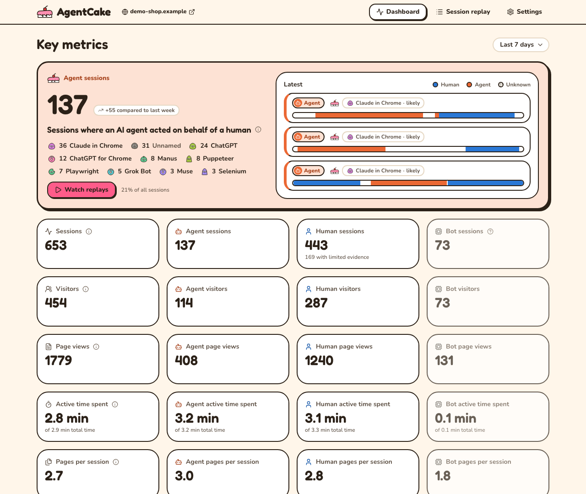
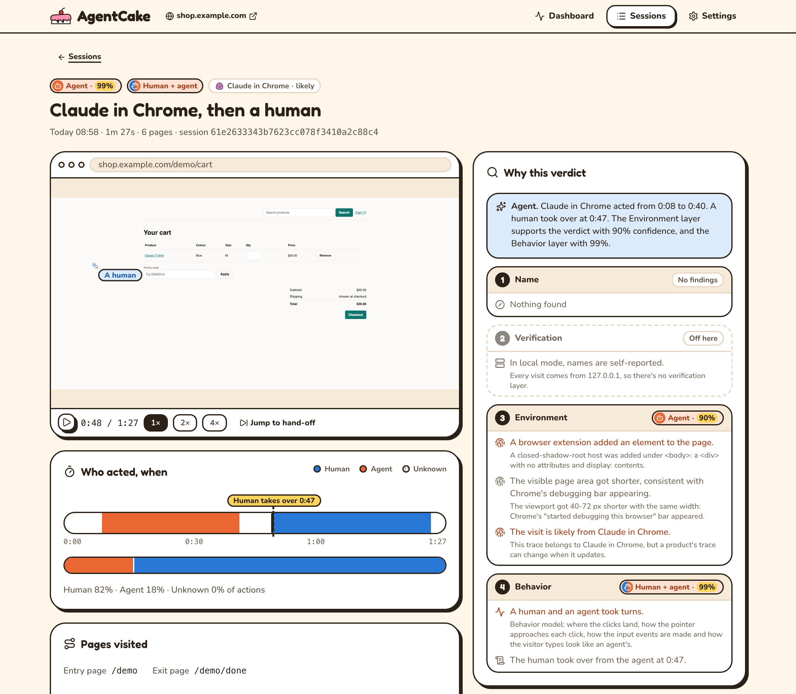
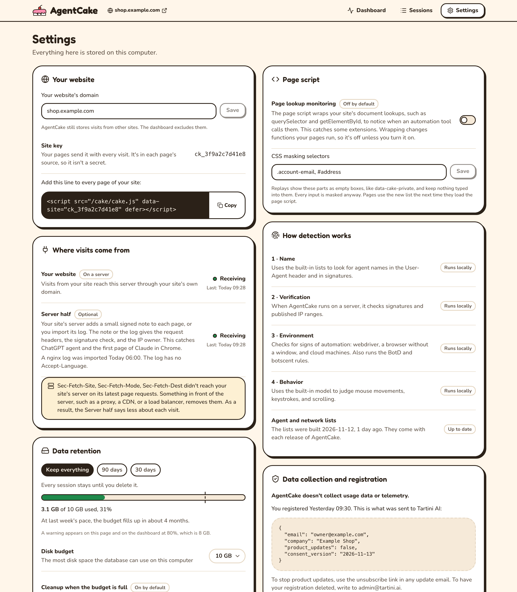

<div align="center">


# AgentCake — AI Agent Behavior Analysis

**自己部署的 session 回放，分得清真人和 AI agent。**

AgentCake 帮你识别访问你网站的 AI agent：它告诉你哪些访问是真人、AI agent 还是 bot，以及真人和 agent 什么时候轮流操作。每个 session 都带回放和判定理由。它跑在你自己的电脑或服务器上：一个程序、一个小数据库，不发遥测。

[](https://github.com/tartini-ai/agent-behavior-analysis/releases)
[](https://github.com/tartini-ai/agent-behavior-analysis/issues)
[](../../../LICENSE)

[English](../../../README.md) · **简体中文**

</div>



*录自一个测试网店：Claude in Chrome 把一件 T 恤加进购物车，然后真人接手去结账。回放跳到接手点，旁边是四层判定理由。*

## 安装

在一个新的空文件夹里打开 Claude Code、Codex 或别的 coding agent，把这句话贴进去：

```text
帮我用 curl 或 GitHub CLI 安装 AgentCake 0.4.0，照着
https://raw.githubusercontent.com/tartini-ai/agent-behavior-analysis/v0.4.0/INSTALL.md
做，最后告诉我打开哪个本机页面，以及怎么接上我的网站。
```

你的 agent 会下载发布文件、核对校验和、安装 `agentcake` 命令、启动它并运行 `agentcake doctor`。然后在浏览器里打开 http://127.0.0.1:7878/ 即可。

- **要求：** macOS 或 Linux，装有 Python 3.11 或更新，或者装有 uv（它自带 Python）。
- **第一次打开：** 用邮箱注册（[会发送什么](#数据留在你手里)），页面接着一步步带你接上你的网站。
- **手动安装：** [`INSTALL.md`](../../../INSTALL.md) 有同样的步骤，每步一条命令。
- **私有预览：** 仓库还是私有的时候，先登录 GitHub CLI（`gh auth login`）。你的 agent 会用 `gh release download v0.4.0 --repo tartini-ai/agent-behavior-analysis` 下载发布文件。

## 看板

**真人和 AI agent，并排看。**


- **agent 排在前面。** 有 AI agent 替真人操作的 session 排在最前，分成「Agent only」（全程是 agent）和「Human + agent」（真人和 agent 轮流操作）。每个 agent 按名字列出，比如 Claude in Chrome、Comet 或 Playwright，认不出名字的标「Unnamed」。
- **每次访问都计数。** Human、Agent 和 Bot 各有自己的数。AgentCake 判断不出来的 session 算作 Human，标上「Thin evidence」（证据不够），判定理由里写明为什么。bot 会保留，但不进 agent 的图表。
- **它们来做什么。** 每类 session 持续多久、来了哪些 agent，以及 agent 最常看的页面和真人最常看的页面并排。

## Session 和回放

**看 agent 做了什么、从哪里接手。**



- **回放。** 每个 session 都能照访客看到的样子回放，所有输入都遮住。
- **谁在什么时候操作。** 时间线分成真人、agent 和未知（Unknown）几段，标出每次接手；每个操作都列出是谁做的。
- **为什么这样判定。** 四层各说自己看到了什么：agent 的名字、名字的验证、浏览器环境和行为。

## 怎么判断

**四层，都在你自己的机器上算。不调用任何 AI 服务。**

- **名字和验证。** 名字来自 User-Agent 和签名请求，对照随每个版本发布的名单。装在服务器上时，签名和公开的 IP 段会核实它们。
- **环境和行为。** 自动化痕迹、接管页面的浏览器插件，以及鼠标、键盘和滚动怎么动。
- **能认出什么。** 报出名字或给请求签名的 agent（ChatGPT agent、Manus、Grok）；会在它操作的页面上留标记的 agent（Claude in Chrome、Comet、Browser Use）；自动化工具，按它们留下的痕迹认出名字（Playwright、Puppeteer、Selenium）。
- **还认不出什么。** 像真人一样移动和打字、不报名字也不留痕迹的 agent，可能被当成真人。在留出的数据上，23 个 Claude in Chrome 回放里有 17 个判成 agent，但 39 个大概率是真人的回放里也有 1 个判成 agent。接手点只有 29.5% 能在 3 秒内找到（[怎么测的](../../../eval/README.md)）。

## 数据留在你手里

**不发遥测。访客做的事留在你自己的机器上。**

- **什么都不往外发。** 页面脚本只把访问发给你自己的 AgentCake。AgentCake 不发使用数据，只在你要求时联网：注册、更新名单（`agentcake lists update`）或检查你自己的网站（`agentcake doctor`）。
- **从不记录。** 访客输入的内容、按了哪个键、密码、卡号、cookie 和 IP 地址。如果你的网站先征求访客同意，就由它开始和停止录制（`window.cake.start()`、`window.cake.stop()`）。
- **只注册一次。** 第一次打开本机页面时，它会请你注册。你的邮箱、你填了的话还有公司名、要不要产品更新、看到的是哪一版同意文字，只在你按下「Register & Continue」时才发给 Tartini AI。收集访问和命令行不注册也能用。



[`PRIVACY.md`](../../../PRIVACY.md) 写了记录什么、存在哪里、怎么删除；[`docs/privacy-notice-template.md`](../../privacy-notice-template.md) 帮你告诉访客。

## 接入你的网站

**页面里加一行，服务器上可选加一段中间件。**

注册以后，本机页面分四步带你接上：你网站的地址、AgentCake 跑在哪里、页面脚本、第一次访问。第三步给了一句给 coding agent 的话，在你网站的代码文件夹里贴进去就行。那句话里写的是你这份 `agentcake` 的完整路径，大致是这样：

> 在这个网站的代码目录里运行 `agentcake setup --print --site`，按它打印的步骤把 AgentCake 接到这个网站上，最后运行 `agentcake doctor`，告诉我结果和还剩什么要我做。

- **页面脚本。** 页面里加一行，载入 cake.js（gzip 后 45 KB）。它的检测等页面加载完、浏览器空闲时才跑。
- **服务器那一半。** 对 Next.js、Express、Flask、FastAPI、Django、PHP 和 WordPress，setup 还会打印一段中间件，把你的服务器看到的每次页面请求告诉 AgentCake。
- **本机或公网。** 跑在这台电脑上的网站马上就能发来访问。公网网站的访客需要把 AgentCake 装到服务器上。

## 装到服务器上

**给公网网站的访客用。**

- **同一个程序，服务器模式。** 只有页面脚本和收集接口是公开的，放在你自己网站的一个路径下。看板只在服务器的 127.0.0.1 上，通过 SSH 隧道打开。
- **Docker 或 systemd。** 作为容器运行，或者作为系统服务运行。
- **验证会打开。** 在服务器上，签名和公开的 IP 段能核实 agent 是谁。

[`SERVER.md`](../../../SERVER.md) 有每一步。

## 从源码构建

- **发布文件：** `python3 -I tools/release.py build` 从当前提交构建 wheel、`agentcake.pyz`、发布文件夹和 `SHA256SUMS`；用法见 `python3 -I tools/release.py --help`。
- **交给 coding agent：** 给它 [`AGENTS.md`](../../../AGENTS.md)。里面写了怎么从这个文件夹运行 AgentCake，以及怎么改它的界面（[`DESIGN.md`](../../../DESIGN.md)）。
- **测试：** `python3 -I -m unittest discover -s tests -v`。
- **参与贡献：** [`CONTRIBUTING.md`](../../../CONTRIBUTING.md) 写了怎么从源码运行、pull request 要通过哪些检查，以及这些检查守着哪些规则。

## 反馈

- **常见问题：** [`docs/FAQ.md`](../../FAQ.md) 回答常被问到的问题，比如准确率多高、Human、Agent 和 Bot 各是什么意思、会不会拦下 agent。
- **Bug、判错和建议：** [GitHub Issues](https://github.com/tartini-ai/agent-behavior-analysis/issues)。
- **安全漏洞：** 请不要开 issue，写信到 [admin@tartini.ai](mailto:admin@tartini.ai)。[`SECURITY.md`](../../../SECURITY.md) 写了报告里要写什么、哪些在范围内。

## 许可证

MIT，版权归 Tartini AI：见 [`LICENSE`](../../../LICENSE)。AgentCake 打包的第三方代码（rrweb、BotD、botscent 和 bot 名单）保留各自的许可证，列在 [`THIRD_PARTY.md`](../../../THIRD_PARTY.md)。

<sub>AgentCake 是独立产品，和它提到的 agent 与工具的厂商没有关联，也没有得到它们的认可或赞助。所有商标归各自所有者。</sub>
